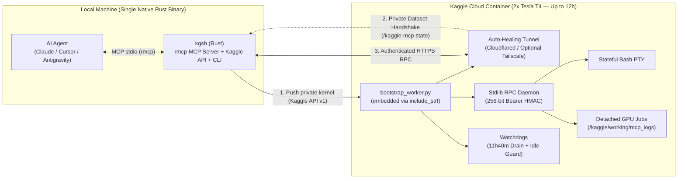

# kaggle-shell-mcp (`kgsh`) ⚡ — Rust Edition

**Turn free 12h Kaggle Dual-T4 GPUs into live, stateful remote terminals & detached job runners for AI Agents via MCP — compiled as a single native Rust binary with zero local Python dependencies.**

> Forked & rewritten in **Rust** from [`NguyenQuocDat06-AI/kaggle-shell-mcp`](https://github.com/NguyenQuocDat06-AI/kaggle-shell-mcp).

[](./LICENSE)
[](https://www.rust-lang.org/)
[](https://modelcontextprotocol.io/)

[**Tiếng Việt (Vietnamese Guide)**](./docs/README.vi.md) · [**Architecture Spec (VN)**](./ARCHITECTURE.md) · [**Contributing**](./CONTRIBUTING.md)

---

## Why `kaggle-shell-mcp` (Rust)?

Kaggle offers ~30 hours/week of free **Dual NVIDIA Tesla T4 GPUs (`2 × 15 GB = 30 GB VRAM`)**, yet its official API (`kaggle kernels push`) only supports fire-and-forget batch runs.

**`kaggle-shell-mcp`** (CLI binary: **`kgsh`**) bridges the gap as a **single, instant-startup Rust binary**:
- **Zero Local Python / SDK Required**: Talks directly to Kaggle's official API (`https://api.kaggle.com/v1/...`), manages private dataset handshakes, packs/unpacks `.tar.gz` archives, and runs an official `rmcp` MCP `stdio` server natively in Rust.
- **Zero Extra Accounts Required**: Needs **only** `KAGGLE_USERNAME` and `KAGGLE_KEY` (`KGAT_...` bearer token or legacy hex key). No ngrok account, no VPN client required (optional Tailscale userspace mode is also supported).
- **100% Native CUDA Environment on Kaggle**: Embeds the self-contained stdlib Python PTY & RPC worker (`src/remote/worker_template.py`) directly inside the compiled binary via `include_str!` and runs it inside the Kaggle Kernel runtime—preserving Conda, PyTorch, `PATH`, and `LD_LIBRARY_PATH` out of the box.
- **Agent-First Execution Split**:
  - `term_exec` — Stateful `/bin/bash` PTY (preserves `cd`, `export`, virtualenvs) for fast interactive exploration and debugging.
  - `job_spawn` / `job_logs` — Process-group isolated background jobs that survive network drops, with automatic `tqdm` carriage-return (`\r`) compaction so progress bars never blow up LLM context windows.
- **Built-In Quota & Snapshot Watchdogs**:
  - **11h40m Safe Drain**: Sends `SIGTERM` at `11h35m` so training loops flush checkpoints, then exits cleanly (`exit 0`) at `11h40m`—ensuring Kaggle commits your `/kaggle/working` (20 GB) output snapshot instead of killing the container at the 12h cliff.
  - **10m Idle Guard (Default On)**: Automatically shuts down cleanly (`exit 0`) after 10 minutes idle with no running jobs and `< 3%` GPU utilization (`idle_timeout_min=10` by default; pass `idle_timeout_min=0` or `kgsh up --idle 0` to disable).

---

## Architecture



---

## Quickstart (60 Seconds)

### 1. Build / Install (Rust)

```bash
cargo build --release
# Binary is at:
#   Windows: .\target\release\kgsh.exe
#   Linux / macOS: ./target/release/kgsh

# Or install globally onto PATH (~/.cargo/bin/kgsh):
cargo install --path .
```

### 2. Add Your Kaggle Token

Create a `.env` file in the project root (or `~/.kaggle_mcp/.env`, or pass environment variables directly in your MCP config):

```ini
KAGGLE_USERNAME=your_kaggle_username
KAGGLE_KEY=KGAT_your_api_token_here
```

*(Get your token from [kaggle.com/settings](https://www.kaggle.com/settings) → **API** → **Generate New Token**. Also supports `~/.kaggle/kaggle.json` and `~/.kaggle/access_token`. Make sure your Kaggle account is phone-verified so GPU accelerators are unlocked.)*

### 3. Connect Your AI Agent (MCP)

#### Claude Desktop / Cursor / Antigravity (`mcp_config.json`)

```json
{
  "mcpServers": {
    "kgsh": {
      "command": "/absolute/path/to/target/release/kgsh",
      "args": [],
      "env": {
        "KAGGLE_USERNAME": "your_kaggle_username",
        "KAGGLE_KEY": "KGAT_your_api_token_here"
      }
    }
  }
}
```
*(On Windows, point `"command"` to `C:/path/to/target/release/kgsh.exe` or simply `"kgsh"` if installed via `cargo install --path .`. If `.env` is present, the `"env"` block is optional.)*

#### Claude Code CLI

```bash
claude mcp add kgsh -- /absolute/path/to/target/release/kgsh
```

---

## MCP Tools Reference

| Tool | Purpose |
| :--- | :--- |
| `kaggle_up` | Provision a headless Kaggle Dual-T4 worker (`gpu=true`, `idle_timeout_min=10` default, `mount_datasets=[]`, `chain_previous_output=false`) |
| `kaggle_status` | Inspect kernel status, live Dual-T4 GPU/VRAM %, RAM, `/kaggle/working` free space, and countdown to safe drain |
| `kaggle_down` | Gracefully terminate the worker (`exit 0`) immediately to stop GPU billing; optionally pull `/kaggle/working` |
| `term_exec` | Run bash commands in a persistent stateful PTY (`cwd`, shell vars, and virtualenvs persist across calls) |
| `job_spawn` | Start long-running GPU training/inference in an isolated process group immune to disconnects |
| `job_list` | List active and completed background jobs with PID, runtime, exit code, and log size |
| `job_logs` | Read tail lines of a job log (with regex `grep` and automatic `tqdm` `\r` cleanup) |
| `job_kill` | Send `SIGTERM` or `SIGKILL` to a background job's entire process group and free VRAM |
| `fs_sync` | `push` local code folders (auto-skipping `.git`, `.venv`, `__pycache__`) or `pull` remote checkpoints/logs via `.tar.gz` |

---

## Standalone CLI Usage (`kgsh`)

Invoke `kgsh` with no arguments to run the MCP `stdio` server, or pass subcommands directly from your terminal:

```bash
# Check status (costs 0 GPU quota)
kgsh status

# Boot a Dual-T4 GPU session (~50s cold start; auto-shuts down after 10m idle by default, use --idle 0 to disable)
kgsh up

# Run interactive commands (stateful PTY)
kgsh exec "nvidia-smi"
kgsh push ./my_project /kaggle/working

# Launch a multi-GPU training job across both T4 GPUs (30 GB total VRAM)
kgsh spawn "torchrun --nproc_per_node=2 my_project/train.py" --name lora-run
kgsh jobs
kgsh logs <job_id> --tail 50

# Pull checkpoints & shut down immediately to save quota
kgsh pull /kaggle/working/checkpoints ./checkpoints
kgsh down
```

---

## Chaining Runs Longer Than 12 Hours

1. Save periodic checkpoints into `/kaggle/working/checkpoints/` inside your training script (and handle `SIGTERM` if desired for the `11h35m` drain hook).
2. After Session 1 exits cleanly at `11h40m`, start Session 2 with `chain_previous_output=true` (or `kgsh up --chain`). Kaggle mounts Session 1's output directly under `/kaggle/input/kaggle-mcp-worker/` at internal datacenter speeds.

---

## Responsible Use

`kaggle-shell-mcp` is built for legitimate machine learning experimentation, model training, and data science workflows on your own Kaggle account. Respect [Kaggle's Terms of Service](https://www.kaggle.com/terms): do not use Kaggle notebooks for crypto-mining, public web hosting, or network proxying, and shut down sessions with `kaggle_down` (or set optional `idle_timeout_min`) when finished so GPUs return to the community pool promptly.

## License

Released under the [MIT License](./LICENSE).
